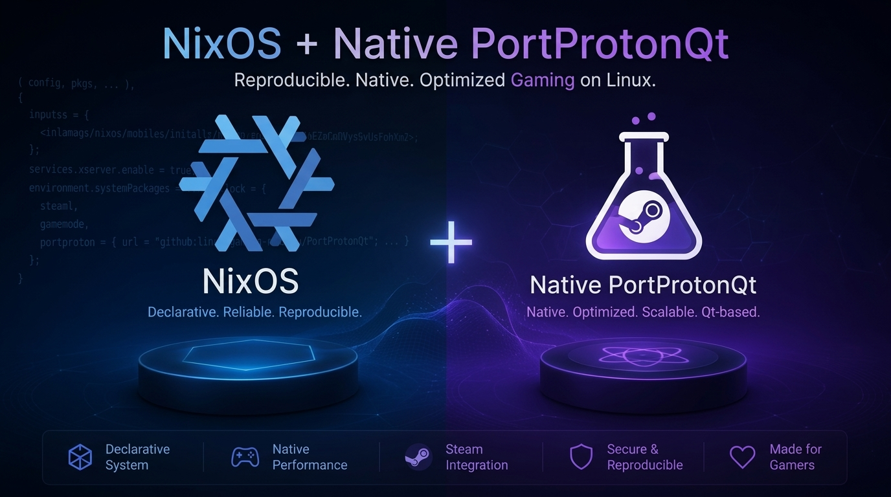

<p align="center">
  
</p>

<p align="center">
  
  
  
  <a href="README_en.md"></a>
</p>

# PortProtonQt for NixOS

Nix-флейк, собирающий **PortProtonQt** — графический интерфейс (PySide6) для
запуска и управления играми из PortProton, Steam, Epic Games Store и GOG.

Собирается **из исходников апстрима** через Meson. AppImage не используется.

## Быстрый старт

```bash
nix run gitlab:dark_siders/portprotonqt-nix
```

или из клона репозитория:

```bash
nix run .#portproton
```

Сборка:

```bash
nix build .
./result/bin/portprotonqt
```

## Что внутри

Весь пакет — один файл `flake.nix`. Отдельных derivation'ов, оверлеев и
директорий `pkgs/` нет: пакет строится из входа `portprotonqt-src`, который
тянет официальный репозиторий апстрима.

| | |
| --- | --- |
| Источник | `git+https://git.linux-gaming.ru/Linux-Gaming/PortProtonQt`, ветка `main` |
| Пин ревизии | `flake.lock` (`portprotonqt-src`) |
| Сборка | Meson + Nix, версия `1.4.1` |
| Python | `python313.withPackages` со всем набором зависимостей |
| FHS-слой | `steam-run` |

## Версия

Пакет собирается **с ветки `main`, а не с тега релиза**: версия в derivation —
`1.4.1`, но исходники всегда свежие. Точная ревизия зафиксирована в
`flake.lock`. Так NixOS-фиксы апстрима подхватываются сразу, без ожидания
следующего релиза.

## Как это работает

PortProtonQt — не только GUI. Он же тянет и запускает **bash-движок PortProton**
(`start.sh`), который скачивает Wine/Proton и запускает игры. Этому движку нужна
обычная FHS-система с glibc, bash и системными утилитами, чего в NixOS нет.

Поэтому пакет запускается через **`steam-run`** — FHS-окружение на базе
bubblewrap, уже присутствующее в nixpkgs. Ничего самодельного: своя FHS-сборка
не нужна, `steam-run` умеет всё, что требуется.

## Правки для NixOS

Апстрим NixOS не поддерживает официально. Две основные проблемы **уже исправлены
в апстриме** (коммит `e25b52f3`), остаётся только строгая проверка в `postInstall`.

1. **Абсолютный интерпретатор в скриптах движка.** `steam-run` отдаёт в
   песочницу `PATH`, где `python3` — чужой интерпретатор из FHS-образа. Он
   подхватывает чистые модули вроде `babel`, но не грузит скомпилированные
   (`orjson`, `pyside6`) — несовпадает ABI-тег. **Исправлено апстримом**:
   `app.py` прописывает `PORTPROTONQT_PYTHON=sys.executable`, скрипты движка
   зовут `${PORTPROTONQT_PYTHON:-python3}`.
2. **Защита `kill_portwine`.** Функция ищет bwrap через
   `pgrep -f wrap | grep PortProton` и шлёт `kill -n 9`. Под `steam-run` этот
   bwrap — собственный контейнер сессии, а у него `--die-with-parent`, поэтому
   всё падало с SIGKILL (код 137) ещё до запуска игры. **Исправлено апстримом**:
   в `functions_helper` добавлен guard `pw_ancestor_pid`, отбрасывающий предков
   текущего шелла из списка на kill.
3. **Строгая проверка подмен** (в `postInstall`). Если апстрим переименует
   переменную `PORTPROTONQT_PYTHON` или уберёт guard `pw_ancestor_pid`, сборка
   упадёт с внятной ошибкой, а не сломается молча у пользователя.

Никаких правок исходников на уровне Python — всё делается на уровне
установленных скриптов.

## Проверки

```bash
nix flake check
```

| атрибут | что проверяет |
| --- | --- |
| `package` | сама сборка |
| `cli` | обёртка зовёт `steam-run` и прописывает `PYTHONPATH`; в скриптах движка нет голых вызовов `python3 -m portprotonqt`; на месте защита `kill_portwine`; `bash -n` сходит для обоих скриптов; CLI отдаёт справку; `orjson` и `babel` импортируются тем же интерпретатором, которым зовут хелперы движка |

Быстрый прогон одного набора:

```bash
nix build .#checks.x86_64-linux.cli
```

## Подключение в свой конфиг

Через inputs (рекомендуется):

```nix
{
  inputs = {
    portprotonqt-nix.url = "gitlab:dark_siders/portprotonqt-nix";
  };

  outputs = { nixpkgs, portprotonqt-nix, ... }: {
    nixosConfigurations.myhost = nixpkgs.lib.nixosSystem {
      system = "x86_64-linux";
      modules = [
        ({ modulesPath, ... }: {
          imports = [ (modulesPath + "/installer/scan/not-detected.nix") ];
          nixpkgs.overlays = [ portprotonqt-nix.overlays.default ];
          environment.systemPackages = [ pkgs.portprotonqt ];
        })
      ];
    };
  };
}
```

Или напрямую во flake-конфиге:

```nix
{
  inputs.portprotonqt-nix.url = "gitlab:dark_siders/portprotonqt-nix";
  # ...
  nixpkgs.overlays = [ inputs.portprotonqt-nix.overlays.default ];
  environment.systemPackages = [ pkgs.portprotonqt ];
}
```

> **Примечание:** пакет зависит от `steam-run` (проприетарный), поэтому нужен
> `nixpkgs.config.allowUnfree = true;` — во флейке он уже задан.

## Права для wine (polkit) — опционально

Апстрим закрыл CVE-2026-59678 в 1.3.1: polkit-правило
`ru.linux_gaming.PortProtonQt.rules` больше не полагается на проверку `ps`, а
даёт привилегии только членам группы `portprotonqt`. На NixOS эта группа не
создаётся системой автоматически. Если хотите разрешить бесшовное монтирование
дисков и правку NetworkManager прямо из GUI, добавьте:

```nix
users.groups.portprotonqt = { };
users.users.YOUR_USER.extraGroups = [ "portprotonqt" ];
```

Без этого polkit-правило просто не сработает (безопасный дефолт) — приложение
продолжит работать.

## Ограничения

- Только `x86_64-linux`: `steam-run` под другие системы не собирается.
- Первая инициализация Wine/Proton заметно дольше обычного: движок качает
  дистрибутивы и компилирует модули уже внутри FHS-окружения.
- Пакет тянет ветку `main` апстрима, а не тег: возможны сюрпризы при обновлении
  `flake.lock`. Фиксированная ревизия всегда в `flake.lock`.
- `gogdl` (GOG) и `legendary` (Epic) в замыкание не входят, но ставить их в
  систему не нужно: сам PortProtonQt скачивает их из официальных релизов
  Heroic в `~/.local/share/PortProtonQt/bin` (со сверкой sha256) и обновляет
  раз в 30 дней. Из `PATH` они берутся только если своего бинаря нет.
- Путь к данным PortProton задаётся в GUI или через `PORT_DATA_PATH`. В флейк
  никакие личные пути не зашиты.
- `meta.maintainers` пуст — для попадания в nixpkgs нужно завести maintainer.

## Лицензия

Nix-выражения флейка — MIT. Сам **PortProtonQt** распространяется под
лицензией **GPL-3.0**.
